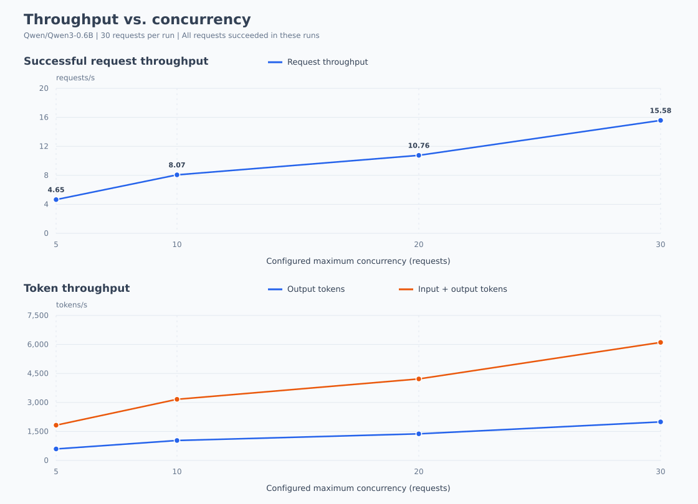
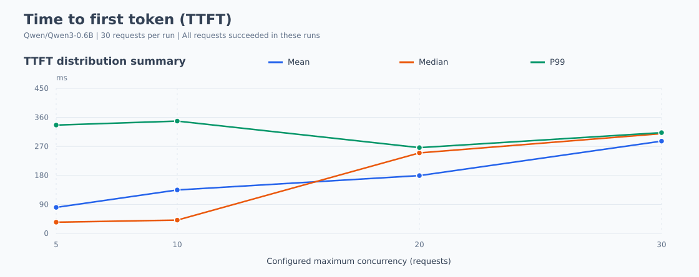
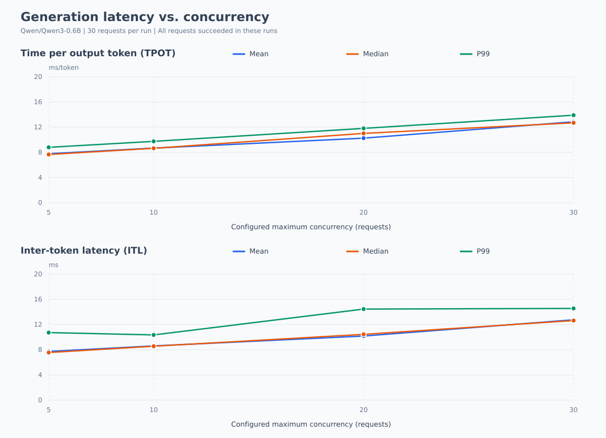
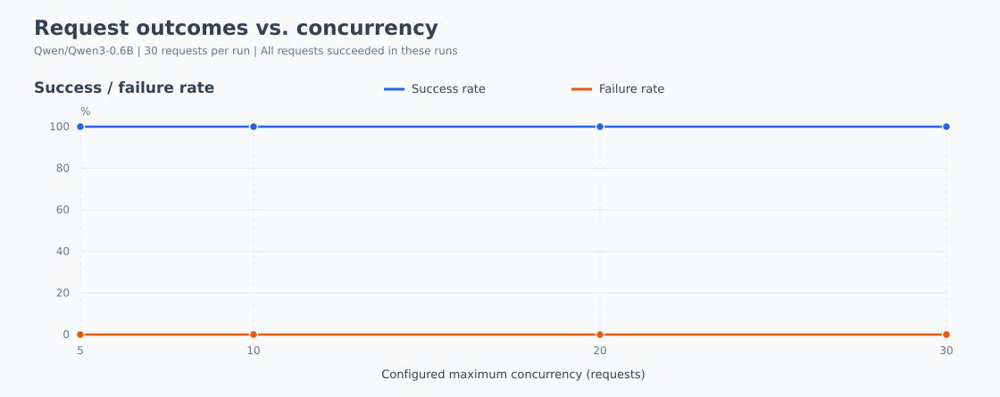
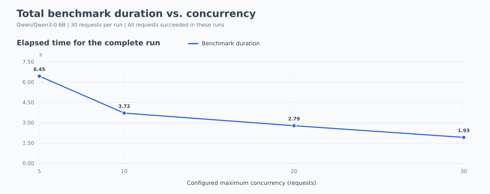

# vLLM 不同并发数 Benchmark 测试报告

> 本报告根据同目录下的新实验 JSON 结果自动整理。本次各组请求全部成功；每组仅运行一次，结果反映本次工作负载的观测性能。

## 1. 测试配置与统计口径

| 项目 | 内容 |
| --- | --- |
| 模型 | `Qwen/Qwen3-0.6B` |
| Tokenizer | `Qwen/Qwen3-0.6B` |
| 接口 / Backend | `openai-chat` / `openai-chat` |
| 每组请求数 | 30 |
| 并发上限 | 5、10、20、30 |
| 请求速率 request_rate | inf（不限制发起速率，受并发上限约束） |
| Burstiness | 1.0 |

- 横轴取 JSON 的 `max_concurrency`（配置的并发上限），按数值从小到大排列。
- 成功率 = `completed / num_prompts × 100%`；失败率 = `failed / num_prompts × 100%`。
- 请求吞吐量 = 成功请求数 / 整组测试耗时；输出吞吐量 = 输出 token 总数 / 整组测试耗时；总 token 吞吐量 = 输入与输出 token 总数之和 / 整组测试耗时。
- TTFT 为首 token 延迟；TPOT 为首 token 之后的平均每输出 token 耗时；ITL 为相邻 token 的到达间隔。延迟表直接采用 benchmark 输出的统计字段，不将失败请求的零值延迟纳入自行计算。
- 延迟的 Mean / Median / Std / P99 分别为均值、中位数、标准差和第 99 百分位；ITL 与请求级指标的样本粒度不同。
- 表格保留 2 位小数，请求吞吐量保留 4 位；折线图使用未舍入的原始数值。折线仅连接本次观测点，不表示中间并发数的实测结果。
- 日期按 JSON 中的 `date` 原样解析，源文件未注明时区。每个并发数仅有一次测试，图中不包含重复实验的误差条。

## 2. 请求完成情况

| 并发上限 | 请求数 | 成功 | 失败 | 成功率 | 失败率 | 测试耗时 (s) | 源文件时间 |
| --- | --- | --- | --- | --- | --- | --- | --- |
| 5 | 30 | 30 | 0 | 100.00% | 0.00% | 6.45 | 2026-10-14 11:07:13 |
| 10 | 30 | 30 | 0 | 100.00% | 0.00% | 3.72 | 2026-10-14 11:07:22 |
| 20 | 30 | 30 | 0 | 100.00% | 0.00% | 2.79 | 2026-10-14 11:07:29 |
| 30 | 30 | 30 | 0 | 100.00% | 0.00% | 1.93 | 2026-10-14 11:07:36 |

## 3. 吞吐量与 token 统计

| 并发上限 | 请求吞吐 (req/s) | 输出吞吐 (token/s) | 总 token 吞吐 (token/s) | 输入 token 总数 | 输出 token 总数 | 峰值输出 (token/s) | 记录的峰值并发 |
| --- | --- | --- | --- | --- | --- | --- | --- |
| 5 | 4.6527 | 595.55 | 1,823.88 | 7920 | 3840 | 643.00 | 10 |
| 10 | 8.0683 | 1,032.75 | 3,162.78 | 7920 | 3840 | 1,140.00 | 20 |
| 20 | 10.7586 | 1,377.10 | 4,217.38 | 7920 | 3840 | 1,595.00 | 30 |
| 30 | 15.5803 | 1,994.28 | 6,107.49 | 7920 | 3840 | 2,153.00 | 30 |

峰值输出、记录的峰值并发分别直接取自 `max_output_tokens_per_s`、`max_concurrent_requests`。后者按秒时间桶累计活跃请求，可能与瞬时峰值、配置的并发上限不同；报告保留原值。

## 4. 延迟明细

| 并发上限 | 指标 | Mean (ms) | Median (ms) | Std (ms) | P99 (ms) |
| --- | --- | --- | --- | --- | --- |
| 5 | TTFT | 80.82 | 34.85 | 106.81 | 336.20 |
| 5 | TPOT | 7.79 | 7.67 | 0.32 | 8.80 |
| 5 | ITL | 7.73 | 7.56 | 1.78 | 10.72 |
| 10 | TTFT | 134.86 | 41.33 | 141.40 | 348.56 |
| 10 | TPOT | 8.68 | 8.65 | 0.30 | 9.75 |
| 10 | ITL | 8.61 | 8.56 | 3.03 | 10.35 |
| 20 | TTFT | 179.42 | 249.87 | 104.06 | 266.20 |
| 20 | TPOT | 10.26 | 11.01 | 1.17 | 11.81 |
| 20 | ITL | 10.18 | 10.44 | 2.93 | 14.46 |
| 30 | TTFT | 286.37 | 309.63 | 50.48 | 312.70 |
| 30 | TPOT | 12.86 | 12.69 | 0.35 | 13.90 |
| 30 | ITL | 12.76 | 12.64 | 4.15 | 14.56 |

## 5. 折线图

### 5.1 吞吐量

上图展示成功请求吞吐量，下图展示输出与总 token 吞吐量，纵轴从 0 开始。

### 5.2 首 token 延迟（TTFT）

### 5.3 生成延迟（TPOT / ITL）

### 5.4 请求成功率与失败率

### 5.5 整组测试耗时

## 6. 本次结果观察

- 并发 **30** 时，本次记录的输出吞吐量最高，为 **1,994.28 token/s**，请求吞吐量为 **15.5803 req/s**，成功率为 **100.00%（30/30）**。
- 该组平均 TTFT 为 **286.37 ms**，平均 TPOT 为 **12.86 ms**，平均 ITL 为 **12.76 ms**。
- 各档失败率：并发 5 为 0.00%；并发 10 为 0.00%；并发 20 为 0.00%；并发 30 为 0.00%。
- 各档位均无失败；每档请求数较少，建议增加样本量与重复次数后再判断稳定容量。

### 错误摘要

| 并发上限 | 错误末行摘要 | 次数 |
| --- | --- | --- |
| 5 | 无错误 | 0 |
| 10 | 无错误 | 0 |
| 20 | 无错误 | 0 |
| 30 | 无错误 | 0 |

## 7. 原始文件与重新生成

- 并发 5：[c5.json](c5.json)
- 并发 10：[c10.json](c10.json)
- 并发 20：[c20.json](c20.json)
- 并发 30：[c30.json](c30.json)

`request_goodput` 为 `null` 时不展示为有效吞吐量；`rtfx` 不作解释。逐请求数组及完整 errors（如已保存）见原始 JSON。

图表为 SVG 格式，可直接在浏览器打开，缩放不失真。分享报告时请同时保留 `charts/` 目录。

使用 `generate_report.py --result-dir <结果目录>` 可重新生成报告和图表（仅使用 Python 标准库）。
